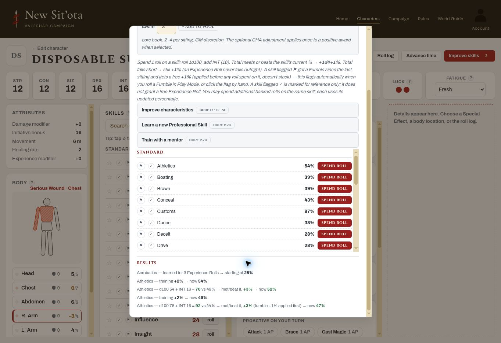

# Subsystem 4 — owner-only live acceptance (a)–(f)

**2026-11-06 (America/Los_Angeles). All six requested steps PASS.** Executed the Claude-review steps (a)–(f) from `advancement-reconciliation.md` using one disposable character. This is live evidence, not a fresh audit of every Core rule or a Subsystem 4 closeout.

## Build, owner and fixture

Read `HANDOFF.md` first and refreshed it after owner sign-in. Live script stamps **`js/play.js?v=74f8277601`** and **`js/app.js?v=56de852493`** match main **`5c738dee37fb080a2d67b2a79003f3f9cf41b006`** (#163). These document references establish the tested build; no claim of a byte-level audit of every asset.

Signed in only as owner **Colemak**; no account created. Fixture **Disposable Subsystem Four**, `bb93c2b5-5bf9-4d30-8bc6-d25ee4d4c256`, created through the builder and saved to the account. Ordinary human Quick Character, legal 100-point allocation, professional skills Commerce/Courtesy/Streetwise. STR/CON/SIZ/POW/CHA 12, DEX/INT 16. No armour, no weapons, no campaign assignment; HR **2**, MP **12/12**. Athletics initially **43%**, banked Experience Rolls **0**. No real character or campaign edited.

## Requested results

| Step | Result | Exact live observations |
|---|---|---|
| (a) Maintained characteristic training, then stopped-training atrophy across awards | PASS | Award **3** rolls (CHA modifier unchecked): pool 0→3. Approve characteristic-training method and add STR step: cost **1**, STR **12→14**, pool **2**. Next award **3**: status **3 rolls, 1 used to maintain training**, pool **4**, STR stays **14**, maintenance **1 roll per award**. Stop the STR step; next award **3** uses **0** maintenance, removes the stopped step, returns STR to **12**, pool **7**. Reload/recovery retains STR 12 and 7 rolls, with no training steps. |
| (b) Fumbled skill +1 before spending an Experience Roll | PASS | Manually mark Athletics with the UI fumble flag (no forced combat die). Spend 1 roll: **43→44** free fumble improvement first; natural **d100 76 + INT 16 = 92 vs 44%**, successful improvement **+3**, final **47%**. Pool **7→6**. Result explicitly says **fumble +1% applied first**. Reload retains 47%, result history and pool; later spends do not repeat the free +1. |
| (c) Mentor +25 and re-training gate | PASS | Athletics **47**, trainer **72** (exactly +25), normal **Trainer (no Teach roll)**, week/GM approval confirmed. Training gains **+2→49%**, no roll-pool cost. Re-training with eligible mentor **74** is refused: **Improve this skill with an Experience Roll before training it again.** No skill change or duplicate history. Reload retains **49% — needs Experience Roll** and still refuses training. Spend 1 Experience Roll: natural **54 + INT 16 = 70 vs 49%**, improvement **+3→52%**, pool **6→5**; pending label clears. Mentor **77** (+25) can now train again: **+2→54%**. Reload retains 54% and the correct history/pool. |
| (d) Learn Professional Skill for 3 rolls | PASS | Confirm education/month of study/GM approval and learn **Acrobatics**. History: **learned for 3 Experience Rolls → starting at 28%**. Pool **5→2**. Reload retains the new skill at 28%, pool 2 and history; no duplicate learning charge. |
| (e) Serious/Major recovery intervals and treatment gate | PASS | Chest max **7**: three direct −3 clicks give **−2/7 Serious**. Panel offers **Apply one week**, HR 2; apply → **0/7**, still Serious. Right Arm max **4**: three −3 clicks give **−5/4 Major**. Panel offers **Apply one month**, HR 2. Unchecked treatment + Apply one month leaves **−5** unchanged and displays **Confirm successful treatment before natural Major Wound recovery (Core p.80).** Tick **GM confirms successful treatment**, apply → **−3/4**, now Serious, with future interval changing to **one week**. Reload retains Chest 0/7 and Right Arm −3/4. |
| (f) Reload after every step | PASS | Reloaded after (a), (b), completed (c), (d), (e), plus an extra mid-(c) reload to test the locked state. Each immediate reload offered the same-owner local-draft recovery prompt; accepted only this disposable character's latest draft. Values, history, training gate and pool survived. Then left to Characters and reopened the saved account character: STR 12, Athletics **54%**, Acrobatics **28%**, pool **2**, Chest **0/7**, Right Arm **−3/4** still correct. No double spending or stale state overwrote the newer results. |

The recovery prompts mean this evidence covers successful recovery of an unconfirmed same-owner save as well as the final account reopen; it does not claim a prompt-free cold reload at each intermediate stage. The displayed transient refusal/status messages disappear when a reload resets transient UI, while the underlying skill/wound/pool state persists.

## Pool reconciliation and dice

`0 +3 −1(training) +3 −1(maintenance) +3 −1(fumbled-skill ER) −1(mentor-gate ER) −3(new skill) = 2`.

Natural Experience Roll dice: **76** and **54**. Both produce +3 skill improvement under the default **1d4+1** path (the gain is shown by the app; no manually selected outcome). Each mentor session's displayed training gain is **+2** with a +25 trainer. Week/month/education/treatment inputs are explicit GM confirmations on this disposable test fixture, not real-world elapsed-time claims.

## Evidence

After the final reload, the advancement history shows the free fumble point, both Experience Rolls, both training gains and learning Acrobatics; Body retains healed Chest and Arm values:

## Cleanup and limits

Deleted only **Disposable Subsystem Four** after verifying its exact name in the confirmation. Waited for disappearance, reloaded My Characters, and confirmed exact-name match count **0**. The five pre-existing character entries remain; owner Account label still identifies Colemak.

No code/tests/workflows/settings/accounts changed. No real campaign data touched. This pass is limited to requested **(a)–(f)**: the subsequently added campaign-option **(g)** (1d6+1 improvement and Weak Passion shift) was **not run**, and no campaign rule was changed. Permanent characteristic purchases, permanent-injury maximum HP, automatic fumble marking from a natural combat Fumble, and the full hazard-note source audit were not independently retested here. Expected rules come from the existing source-verified advancement ledger/reconciliation (Core pp.72–73,80); no new full PDF-source audit is claimed.

All **32** local `tests/*.cjs` scripts passed on the tested main commit, no FAIL/Error/Assertion markers. `git diff --check` passes for these docs. Subsystem 4 remains **OPEN**, overall **4/8**. Claude to review this evidence, reconcile any remaining gate including (g), and request only the remaining focused checks.
