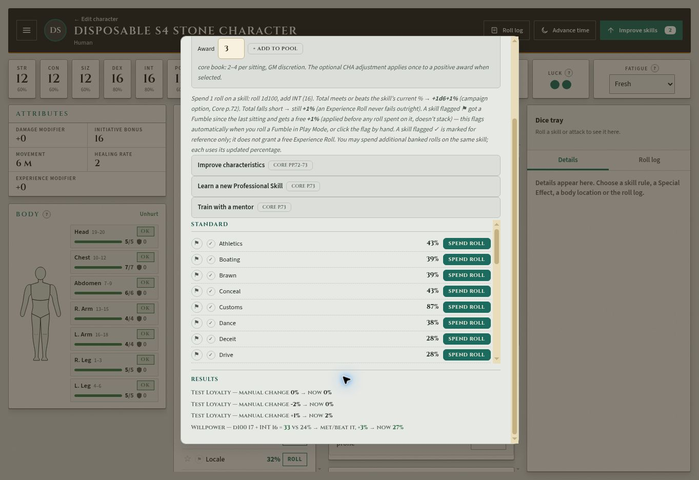
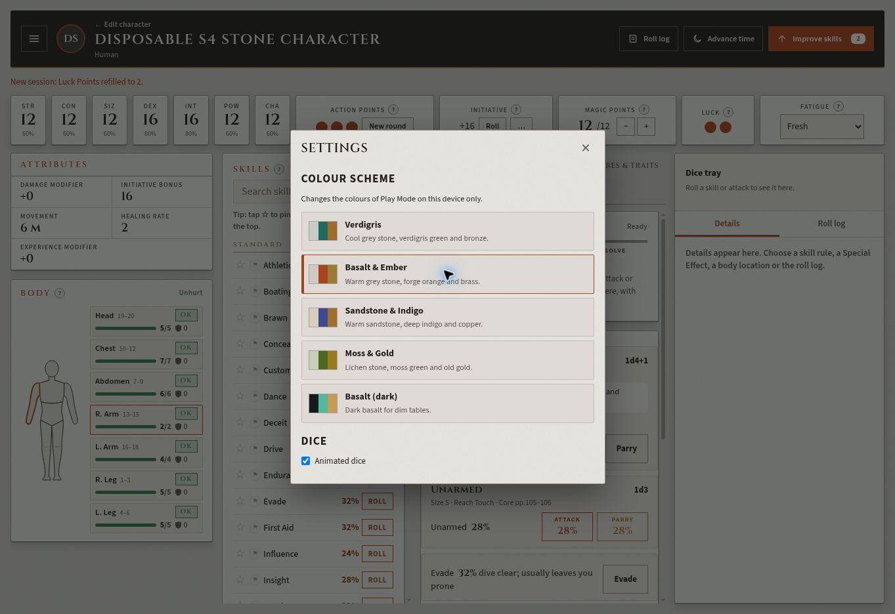
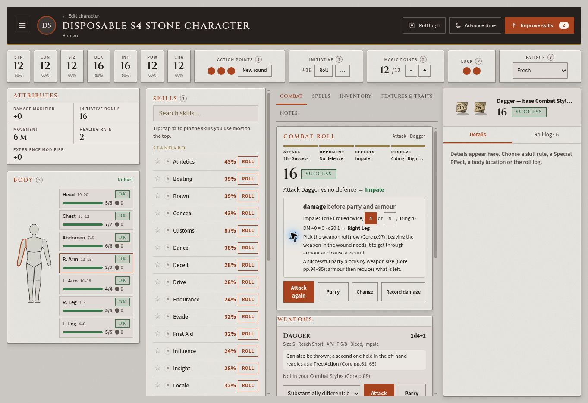

# Subsystem 4 final gates and new desktop Play Mode — live acceptance

**2026-11-06, owner-only (Colemak), desktop 1363×936 CSS pixels.** Read HANDOFF first and followed the final (g)–(i) gate in `advancement-reconciliation.md`. This repeats #172 on the newer deployment and adds the requested desktop glance. No new accounts or code changes. The first supplied login was Test Player; it was signed out before testing or creating fixtures, then Colemak was positively verified.

## Deployment and fixture

Observed page asset stamps: **play.js?v=56772afe28**, **app.js?v=9772b7a37c**, **data.js?v=1a382dcfeb**. This pass covers the new Stone look, menu, Settings, skill descriptions and damage helper visible on that deployment.

Created one **Disposable S4 Stone Campaign** with Skill improvement **Optional: 1d6+1 (faster progress)**, and one linked **Disposable S4 Stone Character**. Quick Human, manual STR/CON/SIZ/POW/CHA12, DEX/INT16, Healing Rate2, maximum Luck2, DM+0, no armour, Dagger. Test Loyalty explicitly started at1%. The campaign listed one character; the improvement panel actually used the campaign formula. Builder Finish's campaign picker omitted the newly created campaign and Play Mode's subtitle read Human; this did not prevent the optional rule applying. Mentioned as a confusing display observation, not a failed rules calculation.

## Requested results

| Check | Result | Live evidence |
|---|---|---|
| (g) Optional 1d6+1 improvement | **PASS** | Awarded3 rolls. Natural Willpower ER **d10017 + INT16 =33 vs24**, met/beat, **+3→27%**, within2–7; pool3→2. Instructions explicitly say **+1d6+1% (campaign option, Core p.72)**. The result history shows the actual gain, rather than repeating the formula. |
| (g) Weak Passion deepen / wane floor | **PASS** | Weak selector says **1d10**. Natural deepen **+1**, Test Loyalty1→2. Wane applied−2→0; another wane applied0→0. Raw wane dice are not exposed, so no raw roll is claimed. Pool remained2. |
| (g) Reload | **PASS** | Immediate reload offered same-owner unsynced-draft recovery; accepted. Willpower27%, Passion0 and complete result history survived. Later navigation to Characters and reopening the account save also retained them, with pool2. |
| (h) Maiming maximum and reload | **PASS** | Clicked Right Arm on the new body figure. Permanent injury maximum started4. Selected displayed **1→2HP** maiming-table outcome, ticked GM confirmation and Set maximum. Immediate reload/recovery retained **Right Arm2/2**, with the other arm4/4. Final saved account reopen also retained2/2. This was a manual GM-adjudicated table selection, not a claim of a natural d3. |
| (i) Luck new-session refill | **PASS** | Luck2/2→1/2 by spending one pip. Advance time said new session refills1of2; Start a new session produced status **Luck Points refilled to2**, both pips active. Final account reopen retained2/2. MP remained12. |
| Hazard-table glance | **PASS** | In the new look, found this via **☰ → Rules reference → Hazards and recovery**, rather than a Body button. Acid(p.68), Falls(p.78), Fire(p.79) tables present and expandable. Reference states nothing is applied automatically. Presence check only, not a new sourcebook audit. |
| Desktop menu → Settings / colour | **PASS** | ☰ exposes site links, Rules reference and Settings. Settings opens a centred window with five named schemes and Animated dice checkbox. Selected **Basalt & Ember** from original Verdigris; accent colours changed and selected state moved. Restored Verdigris afterwards. |
| Skill-name description | **PASS** | Clicked **Athletics** (not its Roll button): right panel shows43%, STR+DEX, summary of climbing/jumping/running and armour, **Corep.38**, and Roll Athletics. No new skill roll was triggered. |
| Attack → opponent → effect → Roll damage | **PASS** | Natural Dagger rolls at28%: **44,37,49,45,88** failures, then **16 Success**; used New round after first3 attempts. Chose No defence, then **Impale** (offered on this successful melee attack). Card showed Roll damage1d4+1. Result: weapon totals **4 or4**, DM+0=0, chosen total **4 damage before parry and armour**; **d20 1→Right Leg**. Selected second4; total/location remained correct. Resolve step shows4dmg/RightLeg. No target sheet or real character damaged. |

No Critical occurred, so this does **not** independently accept a Critical-only branch or Choose Location. Impale was available on the natural Success and was exercised. Equal Impale totals and DM+0 cannot prove the unequal-roll or nonzero-DM regression cases; #170's deterministic tests remain the evidence for those branches.

## Desktop observations for Claude

- Main page fit: `documentElement.scrollHeight = clientHeight =936`, viewport1363×936; columns have their own scroll areas. No sideways page movement observed.
- The dice tray is docked in the right panel. After Roll damage it **still displayed attack16/Success with the d100 pair**, while damage4/RightLeg was in the combat card. Record this as a presentation limitation for review, not a failed damage arithmetic result or a claim that physical damage dice animated.
- Tabs wrap **Notes** onto a second line at this width. Long fixture name/result text is truncated in small step labels. These did not stop the requested flow.
- Newly created campaign missing from Finish's picker and the Human subtitle can make assignment unclear, despite campaign list membership and correct optional rule. Worth a focused UI fix/re-check if not already known.

## Screenshots

## Cleanup and validation

Deleted **Disposable S4 Stone Character**; its absence confirmed after account-list reload, while the original five characters remained. Deleted **Disposable S4 Stone Campaign**; its absence confirmed after campaign-list reload, with only New Campaign and The Pits remaining. The earlier **Disposable S4 Final Campaign** from #172 was absent at both campaign-list checks, resolving that report's cleanup uncertainty. Restored original Verdigris scheme. No private invitation code, credentials or owner email in screenshots/report.

All **33 local tests/*.cjs scripts PASS** on main38e5f0b; `git diff --check` passes. No production code/test edits. The requested live checks all pass with the UI limitations above. Claude should review and decide Subsystem4 closeout; progress remains **4/8 pending that decision**.
