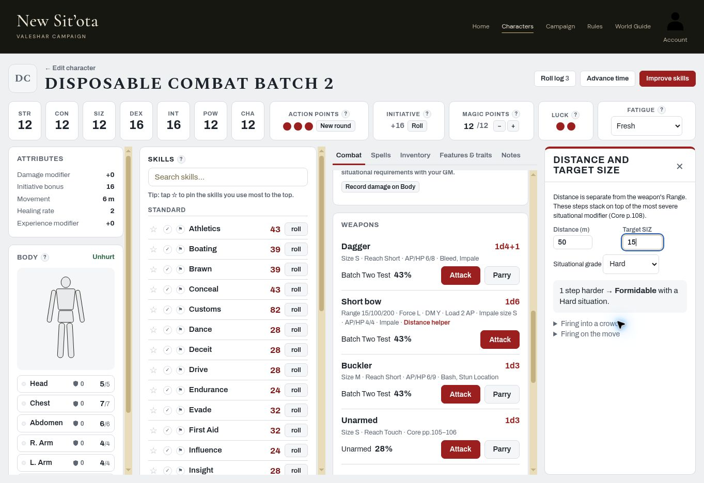

# Combat Batch 2 — PR #144 live acceptance

Tested **2026-11-06 (America/Los_Angeles)** on the live site. **All five requested check groups pass**, with the fumble-observation scope recorded below. No production code changed. Progress remains **3/8**; Subsystem 5 is not closed by this batch.

## Session and fixture

- Site: <https://colemak1.github.io/mythras-character-forge/>.
- Baseline: main `5b70de1bdff3394ee96dcc7850b0ee9dd532cdbe`, merge of PR #144.
- Live page stamps matched the checkout's SHA-256 prefixes: `js/data.js?v=019f618b6a`, `js/engine.js?v=89f2282c4a`, `js/play.js?v=ce20c6c1b1`; also observed `play-clean.css?v=70ed806a1e`.
- All character operations and acceptance tests used **Colemak, the owner**. The first credential submission opened Test Player; it was immediately signed out without reading or modifying any character. No accounts were created.
- Disposable fixture **Disposable Combat Batch 2**, UUID `842d9eef-1c0f-4dc2-aa32-33695a35eb91`, created through the builder's **Quick Character** method (not a full Core creation audit). Manual STR/CON/SIZ/DEX/INT/POW/CHA: 12/12/12/16/16/12/12. Quick Skills pool spent exactly 100, no GM override; style **Batch Two Test 43%**. Dagger, Short bow and Buckler were both included in the style and purchased as equipment. No campaign assignment, no armour, Fresh Fatigue.
- Source: owner's uploaded **`pdfcoffee.com_mythras-2e-2-pdf-free.pdf`**, Mythras Core. Extracted text was searched first; garbled body text/digits required rendered verification of printed pp.89,106,108. Printed page numbers below are book pages, not PDF indices (PDF page = printed page + 1). No book pages/PDF committed.

## Results

| Requested check | Result | Live observation |
|---|---|---|
| 1a. Skirmishing name and Athletics cap | **Pass** | Builder trait search `skirm` showed **Skirmishing**, not a standalone Skirmisher entry. Expanding its description showed running, not sprinting, and that the attack cannot exceed the user's Athletics skill (Core pp.89,108). |
| 1b. Blind Fighting | **Pass** | Expanded Core entry says it ignores penalties from poor lighting or temporary blinding (Core p.89). It does not merely reduce them by one grade. |
| 1c. Mounted Skirmisher provenance | **Pass** | Search result badge reads **Individual · Supplement (not in Core p.89)**, while Skirmishing and Blind Fighting carry Mythras labels. |
| 2a. Dagger without Assassination | **Pass** | Style initially had no traits. Natural Dagger attack 43 at 43% succeeded; selected opponent Failure. The 12 offered effects excluded **Kill Silently**. |
| 2b. Same Dagger after adding Assassination | **Pass** | Returned to builder → Quick Skills, added **Assassination** to the same style, re-entered Play Mode. Natural Dagger attack 11 succeeded; selected opponent Failure. The 13 offered effects now included **Kill Silently**, with a Choose control. No roll result was injected or forced. Core p.89 identifies Assassination as granting access. |
| 3a. Short bow Attack/no Parry; shield Parry | **Pass** | Bow card controls: **Distance helper, Attack**. Buckler card controls: **Attack, Parry**. Dagger and Unarmed also had Attack/Parry. |
| 3b. Bow fumble does not offer Weapon Malfunction | **Pass (observed UI)** | Natural bow rolls were 70 Failure, 44 Failure, 25 Success, then **00 Fumble** (100). With the reference closed, tried opponent Success, Critical, Failure and Fumble: **Weapon Malfunction was never offered**. Success/Critical said the opponent wins 2/3 effects and chooses them; Failure/Fumble produced no effects. See scope note below. |
| 4a. 50m, SIZ 15 | **Pass** | **1 step harder → Hard with a Standard situation.** Matches Core p.108, 41–60m / SIZ 11–20. |
| 4b. 10m, SIZ 100 | **Pass** | **2 steps easier → Very Easy with a Standard situation.** Matches Core p.108, 1–20m / SIZ 81–150. |
| 4c. 130m, SIZ 10 | **Pass** | **4 steps harder → Hopeless with a Standard situation.** Matches Core p.108, 121–140m / SIZ 10 or less. |
| 4d. 150m warning | **Pass** | Displayed **Beyond 140m: continued from the table's progression; confirm with your GM.** Tested with SIZ 10. |
| 4e. Situational grade affects final grade | **Pass** | Kept 50m/SIZ 15: Standard situation gave Hard; changing the situational selector to Hard gave **Formidable**. The helper says distance steps stack on the most severe situational modifier (Core p.108). |
| 4f. Crowd-fire text | **Pass** | Expanded text: edge at least Hard; into/across generally Formidable; an unintended target is hit only when the crowd penalty caused an otherwise successful shot to miss; random victim if multiple in the line; an aware bystander may Evade/Parry; original Special Effects do not transfer. Checked against rendered Core p.108. |
| 5. Optional Closing & Opening Range wording | **Pass** | Combat → Special Effects reference → optional rule includes Size reduced by the difference in Reach, **1d3+1** haft damage, and **two or more Reach steps**. The Short-vs-Medium / Short-vs-Long examples agree with rendered Core p.106. |

**Fumble evidence limit:** the player's failed attack does not present an opponent's selectable effect list; it tells the opponent to choose. This live observation therefore proves absence from the tested bow-fumble UI, not every possible opponent/weapon combination. Separately, automated `C5-B2-X15 Weapon Malfunction is offered only for firearms` passed, including Short bow exclusion and a firearm positive control. The unfiltered **reference** still contains **Weapon Malfunction (Firearms)**; that is a rules reference, not an offered effect for this bow roll.

The optional range reference's final weapon summary also listed Short bow (Long) alongside melee weapons. This was outside the requested corrected-text check; Claude should consider filtering ranged weapons out of that melee-Reach example list.

## Evidence and cleanup

- Deleted **Disposable Combat Batch 2** through its named confirmation. Reloaded the account character list; the disposable name had **0 matches**, and Account still identified **Colemak**. No other character was deleted or edited.
- Restored no real-character resources because all rolls and configuration changes belonged to this disposable fixture.
- Ran all **27** `tests/*.cjs` scripts successfully on the tested baseline; no FAIL/error markers. This includes `tests/combat-batch2.cjs` trait, eligibility, optional-Reach and distance tests. `git diff --check` passed.
- No requested failure needs a code fix from this acceptance batch. Keep broader Combat gaps and owner decisions in the existing case ledger; do not infer full rules completion or backend permission acceptance.
