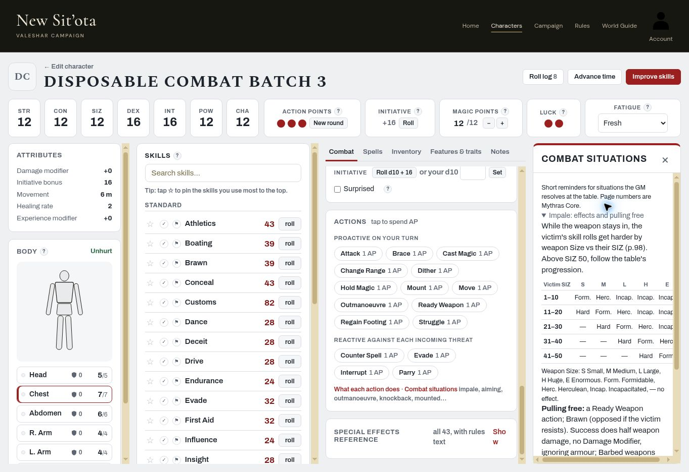

# Combat Batch 3 — live acceptance, 2026-11-06

## Results

Owner-only signed-in acceptance of deployed PR #148 (`5da5b14020ee794a2c3be79170d9e4e001d77e7d`). **Five requested groups pass; Combat situations fails its wider source spot-check.** No code changed.

| Check | Result | Live evidence / Core source |
|---|---|---|
| 1. Whip has no Parry on card, unfamiliar controls or finished-roll quick actions; note explains it | PASS | Initially outside all styles: card contains familiarity selector and Attack only, plus “Can't parry”. Roll **48 Failure vs Failure** finishes with Attack again / Change / Record damage, no Parry. Added Whip to the style through the builder: trained card still Attack only; roll **90 Failure vs Failure** still no quick Parry. Core pp.61,63. |
| 2. Main Gauche plain Success Pin Weapon; Dagger needs Critical | PASS | Main Gauche **21 Success vs Failure** offers Pin Weapon. Repeat **16 Success vs Failure**, chose it and summary records Pin Weapon. Dagger **29 Success vs Failure** omits it; natural **01 Critical vs Failure** offers it. Core pp.61,63,98. |
| 3. Javelin shield condition | PASS | **20 Success vs Failure**, same roll: unchecked checkbox omits Pin Weapon; tick **The target defended with a shield**, it appears and can be chosen; finished summary records Pin Weapon. Core pp.62,65,98. |
| 4. Weapon notes | PASS | Lance: moving mount only. Garrotte: ambush only. Buckler: passive blocks 2 adjacent locations, doubled crouching, and can parry missiles. Atlatl: launcher, +1 Force step and +0/+25/+75m ranges to launched dart/javelin. Core pp.61,63–65; crouching p.105. |
| 5. Combat situations | FAIL | Impale matrix passes all **25 cells** against rendered p.98. Other reminders checked below; Knockback omits an initial metre, and Sweep omits its unusual-size qualification. |
| 6. Serious chest and Major arm wording | PASS | Chest **−2/7 HP**: cannot rejoin even if revived until location healed. Right Arm **−5/4 HP**: five-times-Healing-Rate **minutes** deadline explicitly conditional on severed, punctured or ripped-off limb, in both description and urgent reminder. Core p.110. |

## Failures and confusing wording for Claude

1. **Knockback distance — Core p.104.** The live reminder says 1m per five points (or part) exceeding SIZ. The book first establishes a default **one metre**, then says an excessively powerful blow also pushes the recipient back one further metre for each five points (or fraction) exceeding SIZ. Given SIZ 12 and pre-reduction damage 13, the reminder implies 1m; the source wording gives **2m**. Damage 18 gives **3m**, not 2m. Preserve the correct pre-armour/parry threshold and Easy Acrobatics / Standard Athletics balance check. **The earlier source specification C5-B3-TA22 had the same omission; this docs PR corrects that specification.** #148 followed that inaccurate row; this is a source-audit correction, not an unexplained implementation regression.
2. **Sweep eligibility — Core p.105.** The live reminder starts with a single attack against a group without saying that Sweep attacks occur with weapons or creatures of unusual size. Add this qualification so ordinary human weapon attacks are not implied to have free group targeting. Its single attack roll, separate defender resolutions and simultaneous effects otherwise agree with the source. C5-B3-TA07 is clarified in this PR.
3. **Nonblocking UI label:** Main Gauche and shield-qualified Javelin correctly offer and accept Pin Weapon on ordinary Success, but the choice still carries a **Critical Only** badge. Suppress or qualify that badge when the weapon exception applies. Eligibility and selection pass.

## Combat situations source spot-check

| Section | Result | What was checked |
|---|---|---|
| Impale | PASS | p.98: every cell for SIZ bands 1–10 through 41–50 and Small through Enormous; abbreviation legend and progression beyond 50. pp.97–98: Ready Weapon, Brawn/opposed resistance, half weapon damage without DM or armour reduction, Barbed full damage, embedded weapon cannot parry. |
| Aiming | PASS | p.107: whole Combat Round, reduce one situational penalty by one grade, no stacking from further aiming. |
| Outmanoeuvre | PASS | p.104: group opposed Evade, all participants spend AP; foes failing to beat the manoeuvrer cannot attack that round; beating all permits withdrawal or engagement with one. |
| Sweep | FAIL | p.105: resolution agrees, but unusual-size qualification missing, as above. |
| Knockback | FAIL | p.104: threshold and balance rolls agree; initial metre omitted, as above. |
| Pulling a blow | PASS | p.105: declare before attack; half damage. |
| Climbing / swimming | PASS | p.106: Athletics/Swim caps; one available fighting limb when climbing; underwater thrusting half damage, unarmed exceptions. Water Combat cap exception also agrees with p.89. |
| Mounted / aerial | PASS | pp.103–104: Ride cap / Mounted Combat exception; 1d10+10 vs lower biped, AP to defend mount, faster nonattacking mount withdrawal; opposed Fly/Ride to determine who may attack a pass, charging-through-contact reminder. |

## Build, source and test evidence

- Owner identified in the live Account link as **Colemak** throughout. No other account used or created.
- Initial page served old `play.js?v=0675501922` / `app.js?v=08ad2d615f`. GitHub [Pages run 42270431794](https://github.com/colemak1/mythras-character-forge/actions/runs/42270431794) completed successfully at **18:30:53 UTC**. After reload, observed #148's expected **`play.js?v=9a39c6ed8f` / `app.js?v=7264fbb24a`**. All results above were collected after these new stamps appeared. No manual deployment was dispatched.
- The fixture recovery prompt appeared during the initial reload; accepted only the disposable character's local draft and continued. This was not a reload-regression acceptance test.
- Source: owner's uploaded **Mythras 2e Core**, `pdfcoffee.com_mythras-2e-2-pdf-free.pdf`. Searched parsed text first; rendered printed pp.61–65,89,97–98,103–107,110 to verify rules/tables visually (PDF page = printed page + 1). The sourcebook takes priority over earlier case text. No source PDF or rendered book pages are committed.
- Independently ran all **28** `tests/*.cjs` scripts on #148's merge commit; no FAIL, Error or Assertion markers. [Upstream Tests run](https://github.com/colemak1/mythras-character-forge/actions/runs/42270432294) also succeeded. `git diff --check` passes for these docs.

## Fixture and cleanup

Created **Disposable Combat Batch 3**, `0cc74f78-c74d-4b55-926e-9eec1170fabd`, through the builder. Quick Character, manual STR/CON/SIZ/POW/CHA 12, DEX/INT 16, legal 100-point Quick allocation; style **Batch Three Test** 43%, initially Dagger/Main Gauche/Javelin, later also Whip. Equipped all eight required weapons. No real character was modified.

Deleted that named throwaway after testing. Reloaded My Characters: exact-name match count **0**; the original six entries remain and Account still identifies Colemak. No account was created. No production code, tests or workflow changed.

## Screenshot

The right-side Impale reference on the disposable fixture. The compact panel needs horizontal scrolling for the last column; every cell was verified through the DOM against the rendered book table.

## Next

Claude: correct Knockback/Sweep reminders using the corrected case rows and fix the misleading Pin Weapon badge; run tests, stamp assets and request a focused live re-check. **Subsystem 5 OPEN; overall progress 3/8.**
