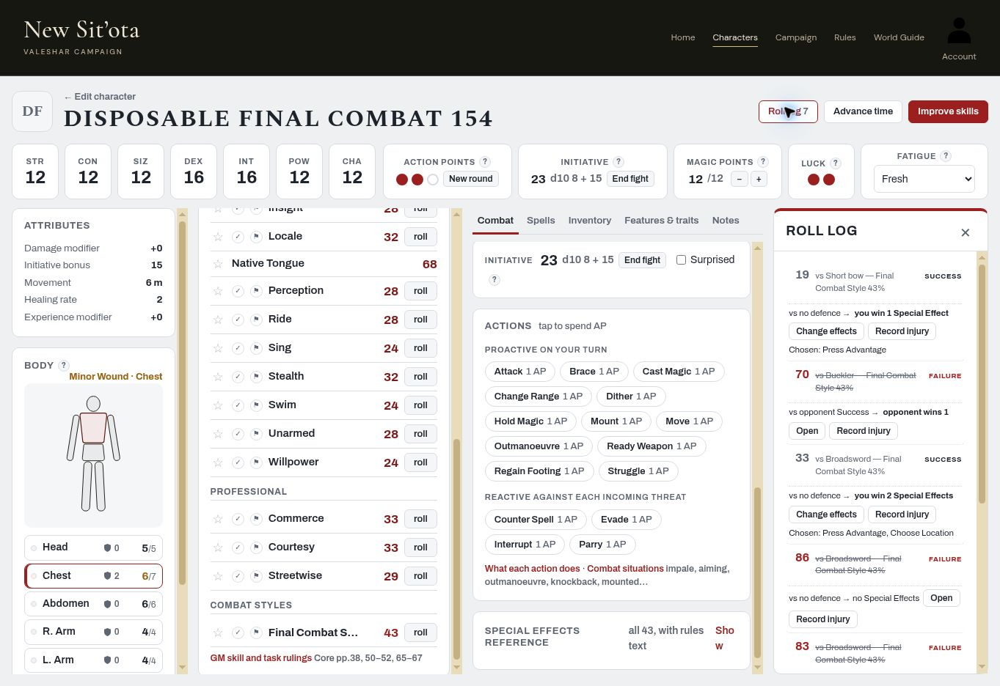
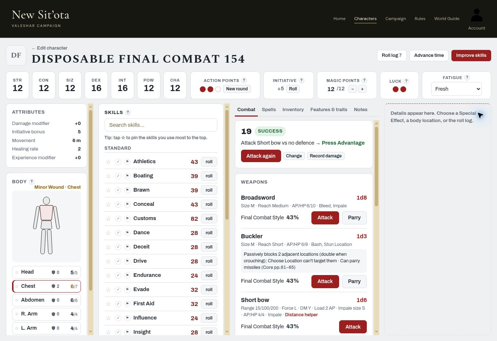

# Combat closeout — one final owner-only fight, PR #154

> **Follow-up resolved:** [PR #156 focused step-8 re-check](combat-pr156-step8-recheck-20261106.md) passes all four requested checks. Both End fight paths now restore AP, clear own Surprised/initiative and persist after reopening. The step-8 failure below is historical evidence from #154, not current live behaviour.

**Date:** 2026-11-06 (America/Los_Angeles). Followed `combat-closeout-review.md` §3, steps 1–8, on one disposable character in one owner-only session. **Steps 1–7 PASS; step 8 FAIL. Subsystem 5 remains OPEN; progress 3/8.**

## Deployment and fixture

Read `HANDOFF.md` first. PR #154 merge: **`a77b1277230ddfe662fd217b6ff335c2850ad218`**. Before creating the fixture, the live document referenced **`js/play.js?v=1ffd5fb573`** and **`js/app.js?v=b7b640e2b8`**, matching that revision's `index.html`. No stale-build rolls were used. These are observed document stamps, not a byte-level audit of every served script.

Signed in as **Colemak**, verified on Account and the Account navigation label; no other account used or created. Fixture: **Disposable Final Combat 154**, `f8706cb3-9636-4431-a450-7ae14aff79cd`, created through the builder, Quick Character, Ordinary human. Manual characteristics STR/CON/SIZ/POW/CHA 12, DEX/INT 16. Legal 100-point Quick allocation, three professional skills and **Final Combat Style 43%** covering Broadsword, Buckler and Short bow; carried those weapons. Chest Padded/Quilted AP 2. No real character or campaign edited.

Initial values: Chest **7/7 HP**, Healing Rate **2**, **3 AP**, unarmoured Initiative Bonus **16**, current worn-armour-adjusted bonus **15**, **12/12 MP**, DM +0. Other locations full: Head 5, Abdomen 6, each Arm 4, each Leg 5. Starting silver 950, remaining 570.

## Results by scripted step

| Step | Result | Observations |
|---|---|---|
| 1. Safe fixture | PASS | Owner verified, legal Quick allocation, required weapons/style and chest AP 2 saved. Exact disposable identity above; no campaign assignment. |
| 2. Initiative / round | PASS | Natural **d10 8 + current Initiative 15 = 23**. Brace spends one AP (3→2); two more Brace declarations empty AP. New round restores 3 AP and preserves 23. Further normal-turn AP spending/new rounds during the same fight also retains that initiative. |
| 3. Attack and Special Effects | PASS | Natural Broadsword rolls **84, 65, 83, 86 Failure**, then **33 Success**, all at **43%**. Each Attack was declared with 1 AP; used New round at exhaustion. Entered **No defence**. Failed attacks have no target-surprise checkbox. On 33 Success, unticked yields **1 SE**; ticking **Target was Surprised, and this is the first successful attack on them** yields **exactly 2 SE, including 1 for surprise**. Own Surprised was **false before and after**. Chose **Press Advantage + Choose Location**; both appear on compact card and roll log. Later bow exchange's checkbox defaults off and earns only 1 SE, so bonus does not carry into an unrelated hit. |
| 4. Incoming attack / shield Parry | PASS | Readied Buckler card: natural **70 Failure at 43%**, after declaring Parry spends last AP (1→0). Entered opponent **Success**: opponent wins 1 SE; changing the same abstract opponent tier to **Failure** shows no effects either way. Restored opponent Success. Calculator: fixed attack damage **5**, Medium attacking Size / Medium Buckler Size, **failed parry** → **blocks 0, 5 remains before armour**. No forced dice or second account. |
| 5. Injury / armour / wound record | PASS | Applied **5** through Chest's **Damage after parry and other reductions, before armour** field. AP 2 automatically subtracts; **3 HP taken**, **7→4/7**, **Minor Wound**. Location records **Last hit: 5 dealt − AP 2 → 3 HP taken**. This is the visible location hit record, not a claim of a separate chronological Minor-Wound log or automatic damage to self from an outgoing Attack. |
| 6. Advance time and reload | PASS (scope noted) | Rest one day advertises exactly 1 Minor-Wound location. Reloaded immediately. Accepted the same-owner disposable-character recovery draft when prompted. Chest **6/7 = min(7,4+2)**, armour **2**, other locations still full; initiative 23 and all six combat rolls/effect choices persist. **MP 12/12→12/12**; because MP began full, recovery from a deficit was not exercised. Later reopening retains the newer healed HP and log; no older draft replaced them. |
| 7. Ranged / Distance helper | PASS | Short bow helper **30m, SIZ 15, Standard situation** says **1 step harder → Hard**. Grade reference shows Standard **43%**, Hard **29%**. The helper/reference does not persist a grade onto the weapon Attack: the actual natural bow roll is explicitly **19 Success at 43%**, not claimed as a 29% roll. Bow card has **Attack, no Parry**, and **Load 2 AP**. Declared ranged Attack for 1 AP after New round; entered No defence, target-surprise box **off**, exactly **1 SE**, chose Press Advantage. |
| 8. End fight and cleanup | **FAIL** | Top-bar **End fight** clears rolled initiative but **does not restore AP or clear own Surprised**. At 2/3 AP, explicitly ticked own Surprised before ending to exercise the reset: afterwards still **2/3 AP, Surprised true**, current bonus **+5** (15−10) with Roll replacing the rolled 23. This state persists after reopening. Chest 6/7, AP armour 2 and seven-roll history persist correctly. **Advance time → End the fight** subsequently restores **3/3 AP**, clears Surprised and shows bonus **+15**. Then deleted only the fixture, waited for removal and reloaded My Characters: exact-name count **0**, Colemak still signed in. |

## Exact fight dice

| Order | Natural die | Roll / result |
|---:|---:|---|
| 1 | d10 **8** | Initiative **23 = 8 + 15** |
| 2 | d100 **84** | Broadsword 43%, Failure |
| 3 | d100 **65** | Broadsword 43%, Failure |
| 4 | d100 **83** | Broadsword 43%, Failure |
| 5 | d100 **86** | Broadsword 43%, Failure |
| 6 | d100 **33** | Broadsword 43%, Success; No defence; surprise adds exactly 1 SE |
| 7 | d100 **70** | Buckler 43%, Failure |
| 8 | d100 **19** | Short bow 43%, Success; No defence; no surprise bonus |

All combat dice came from the normal UI, with no RNG replacement, manual die entry, imported roll, database editing or second fight. Opponent tiers and the fixed 5 damage were entered as the script requires. The grade-reference row was inspected/clicked before the bow attack, but did not produce another logged roll or alter its 43% label.

## Failure for Claude

**Unify or clearly distinguish the End fight controls.** Given spent AP and own Surprised true, the visible top-bar End fight clears only initiative, while Advance time → End the fight clears initiative, restores AP and clears Surprised. The final script expects the complete reset. The observed top-bar behaviour survives reopening; it is not just a stale screenshot. No production code was changed here.

This single fight is complete. Do not claim Subsystem 5 closed from this run. Claude should resolve the narrow step-8 behaviour/label contract and request only the necessary focused re-check rather than repeat the full fight without cause. The MP-at-full and location-hit-record limits above are explicit limits of this evidence.

## Evidence

Roll history shows the surprise exchange earning 2 effects and the later bow exchange earning 1, alongside healed Chest 6/7:

After top-bar End fight, initiative result cleared, AP still 2/3 and bonus +5 while own Surprised remains true (confirmed through the checkbox and after reopening):

## Verification and handoff

All **29** local `tests/*.cjs` scripts passed on the exact #154 merge, with no FAIL/Error/Assertion markers. `git diff --check` passes for the documentation. Only docs, HANDOFF and CHANGELOG changed; no accounts created, code/tests/workflows/settings edited, or real campaign data touched.

**Next: Claude** — review/merge this evidence, address the End fight inconsistency, then reassess the closeout gate. Overall **3/8**, Subsystem 5 **OPEN**.
