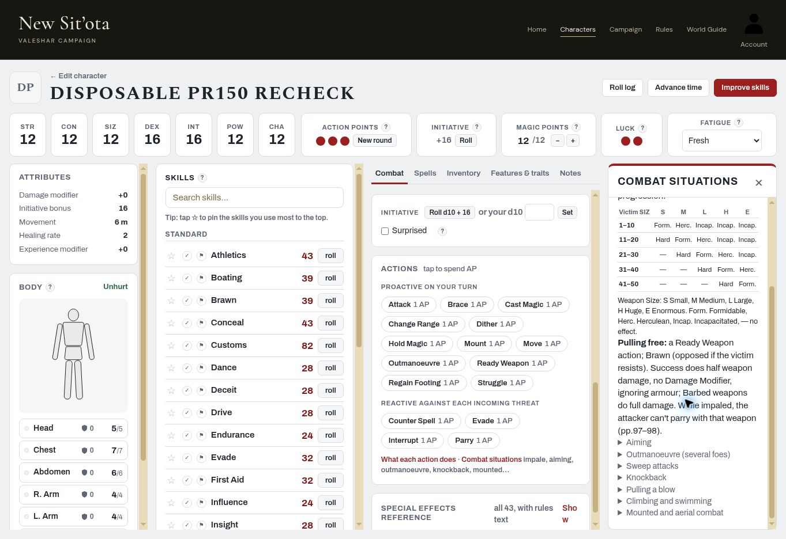

# Combat PR #150 — focused live re-check, 2026-11-06

**All four requested groups PASS.** Owner-only signed-in live session; no account created and no production code changed.

| Check | Result | Evidence |
|---|---|---|
| 1. Sweep eligibility | PASS | Combat → Combat situations → Sweep attacks explicitly restricts sweeping a closely clumped group to weapons or creatures of unusual size, gives dragon-tail/giant-club examples, and leaves number caught to GM. Matches rendered Core p.105. |
| 2a. Main Gauche, ordinary Success vs Failure | PASS | Natural **08**, style **43%**. Eligible effect-list badge says **No Critical needed**; Pin Weapon side panel says **No Critical needed (weapon exception)**. |
| 2b. Javelin, ordinary Success vs Failure, shield ticked | PASS | Natural **31**, style **43%**; ticked **The target defended with a shield**. List badge **No Critical needed**; side panel **No Critical needed (weapon exception)**. |
| 2c. Dagger, Critical | PASS | Natural **02 Critical**, style **43%**, opponent Failure. Both list and side panel retain **Critical Only**. |
| 3. Impale table fits desktop side panel | PASS | At **1363px viewport width**, dialog client/scroll widths both **291px**, table client/scroll widths both **244px**; no descendant horizontal overflow. Screenshot shows all six columns, including E, with no horizontal scrollbar. |
| 4. Knockback unchanged / Core interpretation | PASS | Live reminder retains **1m per 5 points (or part) over SIZ**. Re-read the rendered printed p.104 paragraph and **agree with Claude's C5-B3-TA22 reading**. There is no extra initial metre. |

## Knockback correction

My earlier #149 report was wrong. The opening sentence establishes that an attack exceeding SIZ causes Knockback; it gives no initial distance. The paragraph then describes the balance roll and adds the distance as another consequence. Its “also” does not add a second distance allowance. The later reference to excessively powerful blows distinguishes Knockback from Bash, rather than introducing another metre.

For pre-armour/parry damage exceeding SIZ by 1–5: **1m**; exceeding it by 6–10: **2m**. Easy Acrobatics or Standard Athletics remains the balance roll. **No code change to Knockback is needed.** The previous live report is explicitly corrected in this PR; TA22 already contains the correct interpretation following #150.

## Build and source

- Read `HANDOFF.md` first. Reference main merge **`bab735627ba61da016bb936a652fa8e9ea524796`** (PR #150).
- Reloaded live site; observed **`js/play.js?v=8b2375b770`** and **`js/app.js?v=7264fbb24a`**, matching that revision's `index.html`.
- Account control identifies **Colemak**. Owner only throughout; no account created.
- Source: owner's uploaded **Mythras 2e Core**, `pdfcoffee.com_mythras-2e-2-pdf-free.pdf`. Parsed text had already been searched for this batch; re-read the rendered printed **p.104** directly for this disputed paragraph, with rendered **p.105** as the Sweep reference. PDF page = printed page + 1. No source PDF or book-page images are committed.
- All **28** local `tests/*.cjs` scripts passed on the #150 merge commit; no FAIL, Error or Assertion markers. `git diff --check` passed for the docs changes.

## Fixture and cleanup

Created **Disposable PR150 Recheck**, `63df608e-5ba3-4aff-9441-9e89eadb6d1e`, through the builder: Quick Character, manual human characteristics STR/CON/SIZ/POW/CHA 12, DEX/INT 16; legal 100-point Quick allocation, **PR150 Test 43%** style with Main Gauche, Javelin and Dagger, and those weapons carried. Dice outcomes were generated through ordinary live Attack buttons.

Deleted that named fixture after testing. Waited for its removal, then reloaded My Characters: exact-name match count **0**, the original six entries remain, and Account still identifies Colemak. No real character was edited for these tests.

## Screenshot

## Handoff

PR #150's focused acceptance is complete: **4/4 groups PASS**, with no new code follow-up from this re-check. Claude to review/merge this documentation and resume the next agreed audit work. Subsystem 5 remains OPEN; overall **3/8**, as a focused fix re-check does not close the whole subsystem.
