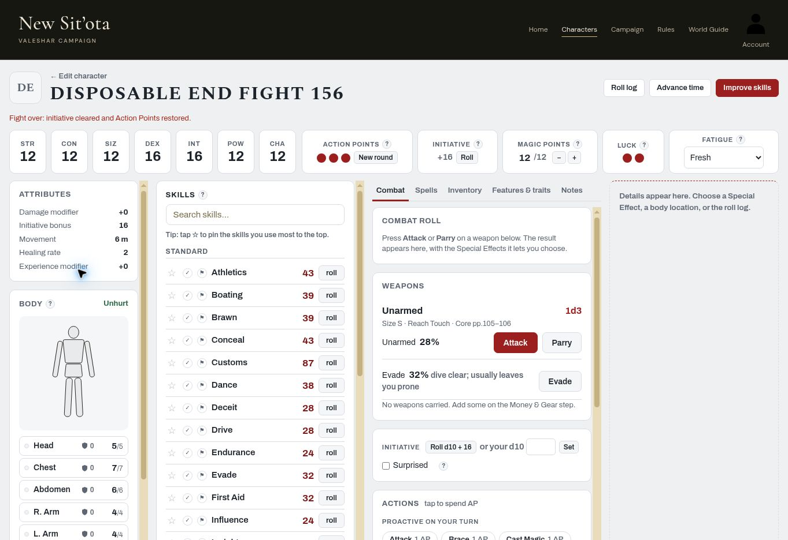

# Combat PR #156 — focused step-8 re-check

**2026-11-06, owner-only live session. All four requested steps PASS.** This re-check resolves the End fight failure reported in [the one final fight](combat-final-fight-20261106.md); the full fight was not repeated.

## Deployment and fixture

Read `HANDOFF.md` first. Baseline: merged PR #156, **`c973b55d1a635078ad70bfa5676b09f39d2d26d6`**. Reloaded live page before testing. Observed script stamps match that revision's `index.html`:

- **`js/play.js?v=3657984677`**
- **`js/app.js?v=6b5bde95b8`**

Account navigation identified **Colemak** throughout; no account created or switched. One fixture: **Disposable End Fight 156**, `fe5b4a23-cace-4944-8aae-844fd9141f3b`. Created and saved through the builder as an Ordinary human Quick Character with a legal 100-point allocation, three professional skills, STR/CON/SIZ/POW/CHA 12 and DEX/INT 16. No weapons or armour needed for this focused reset test. Initial **3/3 AP**, Initiative Bonus **16**, own Surprised off, MP **12/12**. No real character or campaign edited.

## Results

| Requested step | Result | Live evidence |
|---|---|---|
| 1. Roll initiative, spend AP and tick own Surprised | PASS | Natural **d10 7 + 16 = 23**. Declared Brace for **1 AP**, leaving **2/3 AP**. Own **Surprised checked true**. |
| 2. End fight beside initiative resets all three | PASS | Pressed the top-bar initiative **End fight** button. AP **3/3**, own Surprised **false**, rolled initiative removed: plain **+16** and **Roll** replace 23 / d10 7 + 16 / End fight. |
| 3. Reopen: reset state persists | PASS | Characters → named fixture → Play. **3/3 AP, Surprised false, no rolled initiative**, bonus +16. No recovery prompt or stale combat state appeared. |
| 4. Repeat through Advance time → End the fight, then reopen | PASS | Natural **d10 5 + 16 = 21**. Brace spends **1 AP** to **2/3**, own Surprised checked true. **Advance time → End the fight** returns **3/3 AP**, clears Surprised and rolled initiative, shows +16 / Roll. Reopened through Characters again: identical cleared state persists. |

Both controls now perform the same full reset. No attack rolls, forced dice, manual die entry, database edits or repeat of the final integrated fight were used. The only initiative dice were natural **7** and **5**, rolled before checking own Surprised in each setup.

## Cleanup and evidence

Deleted only **Disposable End Fight 156**, after confirming its name in the deletion dialog. Waited for removal, then reloaded My Characters: exact-name match count **0**; the five pre-existing entries remain and Account still identifies Colemak. No account created.

Reopened reset state after the second path; all three AP pips full, initiative cleared and own Surprised unchecked:

## Validation and handoff

All **29** local `tests/*.cjs` scripts passed on the exact #156 merge commit, with no FAIL/Error/Assertion markers. `git diff --check` passes. Docs only: no production code, tests, workflow or settings changed.

The final-fight step-8 failure is now **resolved live**. Retain the earlier steps 1–7 evidence and its explicit limits (MP was full, no deficit-regeneration claim). **Recommend Claude review/merge this evidence and make the final Subsystem 5 closeout decision**, per `combat-closeout-review.md` §4, then continue Advancement reconciliation. Progress stays **3/8 pending that review**; this PR does not independently rewrite the subsystem plan or claim another full fight.
