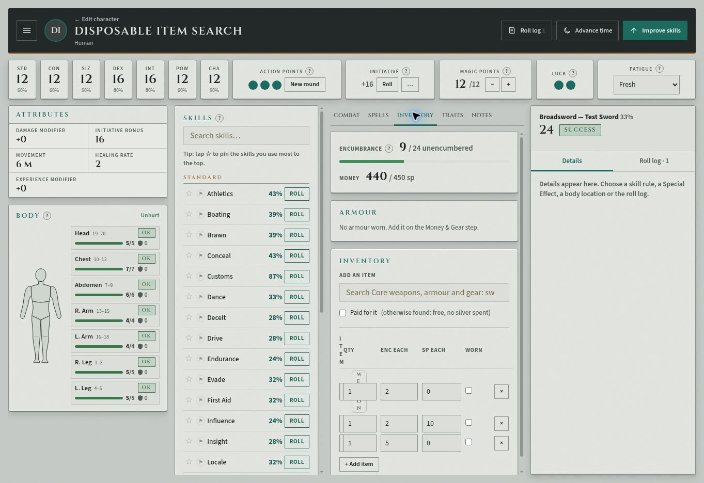
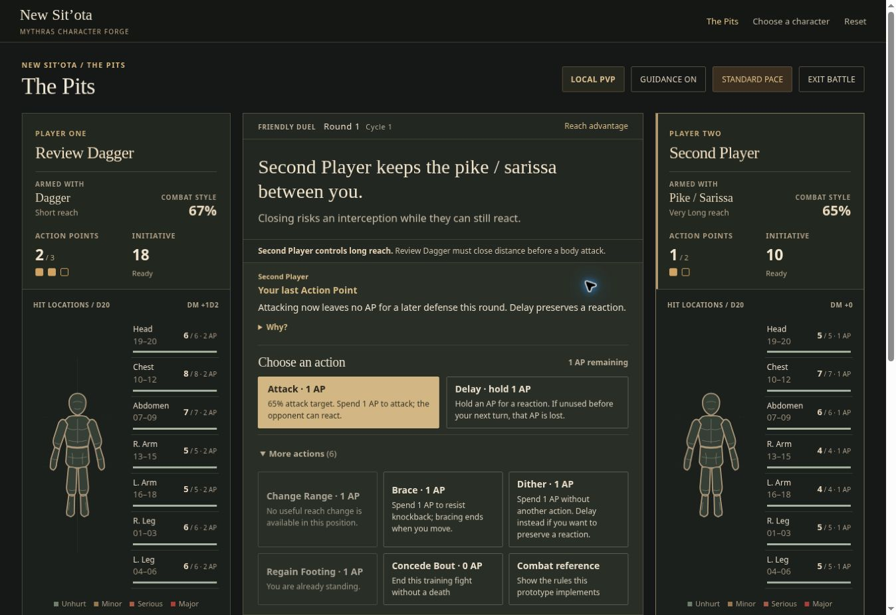

# Item-search live acceptance and The Pits batch-one verification

**2026-11-06 (Los Angeles), Colemak owner session, desktop 1363×936.** Read HANDOFF first. No new accounts, no production/test code changes. One disposable account character; The Pits uses separate built-in local PvP fighters. Progress remains **5/8**; main Play Mode Combat stays closed.

## Deployment and methods

Main app observed assets: `play.js?v=f7983b48bb`, `app.js?v=37f6616cf6`, `data.js?v=ea343c2e36`. Arena shows **Rules prototype v23 · Turn scheduling**. Local verification uses main **f1baab464463230e946d01ea240f961b72e0f2d1**, including #183 batch-one fixes. Arena behavior was exercised through normal visible controls; no browser state/dice injection. Controlled local cases are explicitly separate from natural live rolls.

Rules expectation comes from the existing source-verified ledger `the-pits-combat-procedure-review.md`. For the new parry finding, the owner's uploaded **Mythras 2e Core**, `pdfcoffee.com_mythras-2e-2-pdf-free.pdf`, printed **pp.95 and106** were parsed first and then visually checked on rendered pages because extraction is garbled. No sourcebook pages are committed.

## Item search — functional PASS, layout FAIL

Fixture: **Disposable Item Search**, ID `e0f5f7dc-f253-448f-be9e-b0e04c39404c`. Quick Human, STR/CON/SIZ/POW/CHA12, DEX/INT16, no worn armour; Test Sword style includes Broadsword at33%. Natural starting-money roll produced450sp. No campaign changed.

| Case | Result | Observed evidence |
|---|---|---|
| IS-L01 Free sword search/add | PASS | Search sword offered Broadsword and other swords. Paid for it unchecked. Added Broadsword: ENC0→2, silver stayed450/450; inventory cost0, quantity1, Weapon marker. |
| IS-L02 Combat availability and attack | PASS | Broadsword appeared with Test Sword33%, Attack and Parry. Natural attack **24 vs33 → Success**; roll log/dice tray matched. |
| IS-L03 Paid rope | PASS | Checked Paid for it; searched rope; added **Hemp rope (10m)**, not the2sp rope ladder. Silver450→440; inventory cost10; ENC2→4. |
| IS-L04 Carried mail | PASS | Unchecked Paid for it; searched mail; added **Mail armour, one location**, listed ENC5/900sp. ENC4→9; silver stayed440. All seven body locations retained armour0 and Inventory said no armour worn. |
| IS-L05 Reload and account reopen | PASS | Immediate reload offered same-owner unconfirmed-draft recovery; accepted. All3 items and values persisted. Then Characters→Play reopened saved account copy: ENC9, silver440/450, sword cost0, rope10, mail0, armour still unworn. |
| IS-L06 Core-only builder picker | PASS | Expanded all six trait groups;26 add controls, matching the source-reviewed Core names. Search Mounted Skirmisher produced0 controls. Cleared search; no supplement trait selected. |
| IS-L07 Desktop inventory readability | **FAIL** | In the narrow Inventory column at1363px viewport, all three Item name inputs measure **18 CSS pixels** wide. Names are unreadable, and Item/Weapon labels stack vertically. Quantities/ENC/prices still work. Screenshot below. |

Deleted the named fixture. It disappeared and stayed absent after account-list reload. The owner's other entries, including Goat and Pops, remained; none was selected for edits/deletion. No test campaign created.

## The Pits — batch-one results and limits

All **eight existing `tests/practice-procedure.cjs` tests pass**. Read the affected code and ran **eight additional controlled checks** using the existing VM setup/roll-answer helpers, with new boundary/branch assertions: **seven PASS, one FAIL**. Those temporary scripts were outside the repository; no application or test file was edited. Controlled setup values are not described as natural rolls or live outcomes.

| Batch case | Assessment | Evidence level / result |
|---|---|---|
| PIT-W02 / W03 Major limb | PASS for exercised branches | Existing test confirms resisted Major Arm is prone with no unconditional fatal clock; independent failed Endurance99 on Major Left Leg also leaves prone, records only the conditional limb deadline, and reports unconsciousness. Existing torso test retains its separate deadline. Core p.110. |
| PIT-W09 Ordinary Knockback | PASS for exercised boundaries | Existing tests plus independent totals11,15,16,20 vs SIZ10 give1,1,2,2m. Independent armour99 prevents HP loss while raw17 still triggers Knockback. Core p.104; no extra metre. |
| PIT-SE17 Stand Fast / Bash separation | PASS for exercised branches | Existing test prevents ordinary Knockback and keeps Bash separate. Independent Stand Fast case leaves fighters engaged with no balance prompt. Core pp.99,104. |
| PIT-SE10 Impale choice | PASS for exercised branches | Existing tests run keep-hold and leave-in choices after selecting unequal weapon rolls. Independent armour-blocked Impale yields no lodged weapon, no impaled wound and no leave-choice prompt. Core p.97. |
| PIT-SE11 / SE12 Barbed extraction / injury record | PASS for exercised branches | Existing Trident full versus Shortspear half tests pass. Independent Trident withdrawal rolls8 at Right Arm1/4 →−7; armour99 and larger DM do not reduce/add to withdrawal damage. Wound is recorded before Endurance prompt and Major-wound resolution. Core pp.61,98,110. |
| PIT-R02 opposing-weapon targeting | **PARTIAL / FAIL on parry branch** | Actual Dagger/Pike long-Reach state allows Attack, keeps body HP unchanged and omits Choose Location. Live path also works, but successful parry is ignored when applying weapon damage. New case PIT-R02a below. |

### PIT-R02a — successful parry ignored on the new weapon-target path

**Given:** Dagger at Short Reach versus Pike/Sarissa at Very Long, engaged at the longer Reach. Dagger attacks the opposing weapon. Attack and Pike parry both succeed, with no bypass-parry effect.

**Core:** p.106 allows the shorter weapon to attack the opposing weapon. The normal successful-parry Size reduction table on p.95 blocks all of the smaller Dagger's damage with the larger Pike; p.106 provides no parry-bypass exception for this weapon-target option. Expected: zero damage reaches the weapon's own AP/HP. This applies the general parry rule to the permitted weapon target; it is distinct from spending the Damage Weapon Special Effect and from the unresolved odd-half rounding decision.

**Live reproduction:**

1. The Pits→Fight without a character→Local PvP. First fighter **Review Dagger**, Dagger, style67%; second fighter Pike/Sarissa, style65%. No saved character imported.
2. Natural initiative gives first fighter18, second10. At long Reach, More actions exposes Attack. Its description misleadingly says Close Inside first, although the button is enabled and the legal target is the weapon.
3. Natural attack **13/67 Success**; second player chooses weapon Parry, whose explanation promises **all damage blocked on success**.
4. Natural parry **24/65 Success**. Arena nevertheless requests Strike the weapon damage. Natural total **6**; chronicle states Pike4AP stops4, **2 weapon HP lost,10 remaining**. Both body HP sets remain unchanged.

**Independent controlled reproduction:** real Reach state (no override of `canAttackBody`), Dagger weapon roll4+bonus1 and DM2 =7. Pending reaction parry, defending roll Success, no bypass. Expected Pike HP12→12; actual **12→9**, log says4AP protects it and3HP lost. Seven other independent checks pass. Source `resolveHit()` takes its early `p.vsWeapon` branch before the normal parry-reduction path.

**Status: FAIL / needs code**, plus misleading attack-target copy. Claude should add a regression covering successful parry on weapon-target attacks, then apply permitted defence reduction before the target weapon's AP/HP. Confirm equivalent shield and bypass/evade branches as part of that focused fix. This is not a request to change the pending owner parry-rounding decision.

The live bout was exited using Exit battle; setup screen returned. No leaderboard run completed and no saved account character was used. Severe wound, Knockback and extraction cases above were controlled **local** verification, not falsely labelled live encounters. The full51-case Pits backlog remains open.

## Validation and next action

All **37 existing local test scripts pass** on f1baab4, including the eight procedure tests. Additional independent assertions: **7/8 PASS,1 FAIL** (PIT-R02a). Thus a green current suite does not certify the missing parry branch. `git diff --check` passes.

Claude, when credits return: fix **IS-L07** item-name column sizing, **PIT-R02a** weapon-target parry handling and its target-description copy, then proceed with the already queued batch-two work. No code changed here; overall subsystem progress remains **5/8**.
