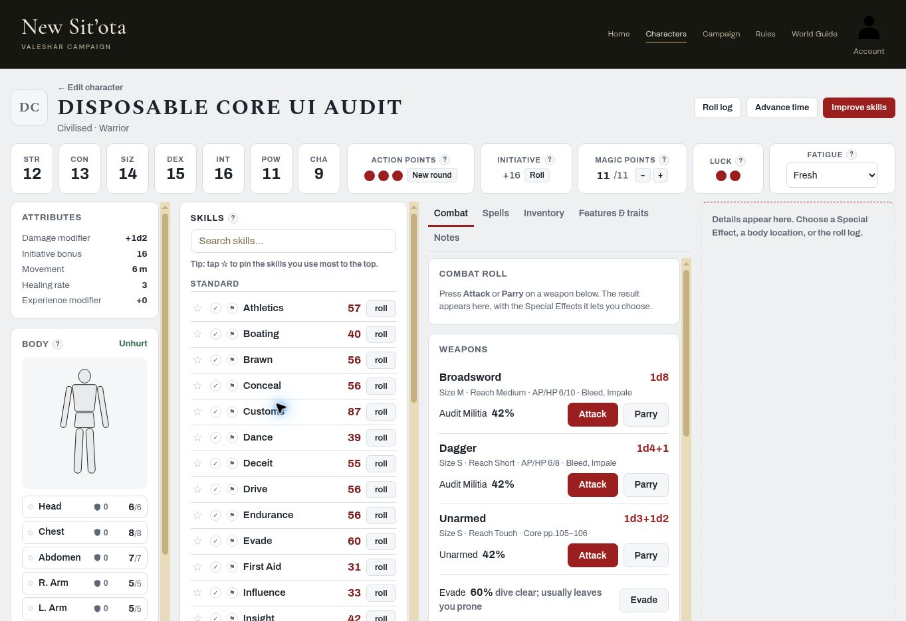
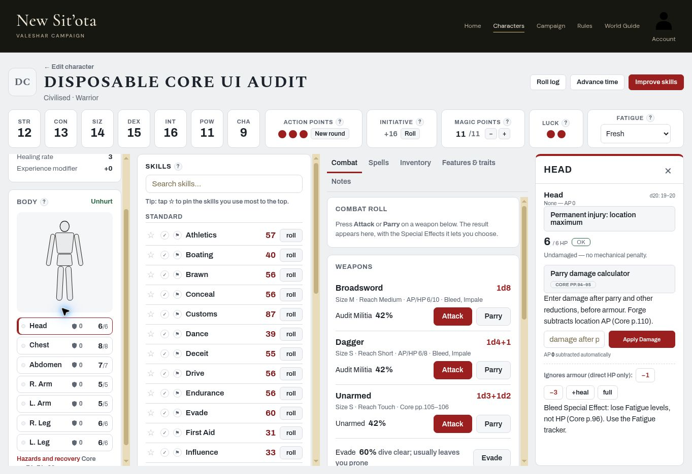
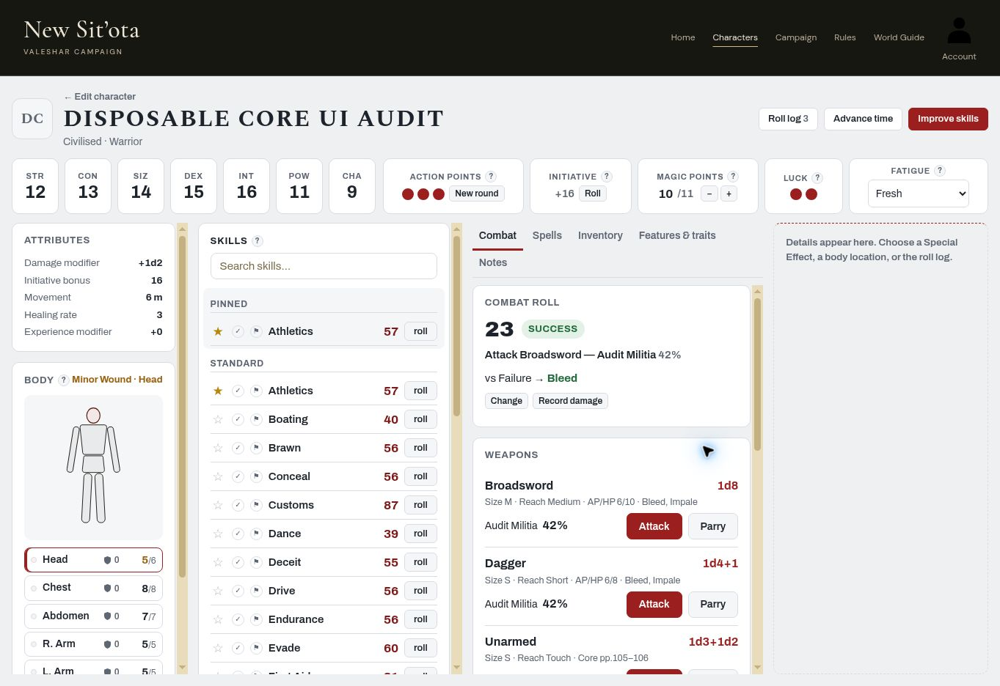
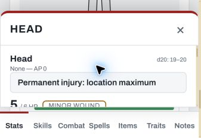

# Play Mode and fresh-character live acceptance

Tested 2026-11-05 (America/Los_Angeles), signed in **only as owner Colemak**. No accounts were created. No application code or database policy was changed in this batch.

**Part A: FAIL / incomplete acceptance.** Desktop page overflow and combat-result compaction do not meet the requested design. The exact 390px phone check remains blocked by the available browser controls; supplemental narrow-layout observations are below.

**Part B: PASS for derived values, all 22 Standard skill bases, allocation controls, Minor Wound healing and actionable Fatigue grades. FAIL for terminal Fatigue wording only:** Comatose/Dead are presented as Hopeless rather than their distinct Core states. A Comatose skill attempt was correctly refused; this is not evidence that the app permits activity while comatose.

Progress remains **3/8**. This small acceptance batch does not close a subsystem or verify multi-account permissions.

## Environment, fixture and sources

- Live site: <https://colemak1.github.io/mythras-character-forge/>.
- Source baseline: main `877a6de13acaf499303150c79c99f9c6e00ecd31` (PR #140). Live asset stamps matched this checkout's SHA-256 prefixes: `js/play.js?v=923f3312a7`, `play-clean.css?v=901aa454f1`, `js/render.js?v=5d6f8a8cca`, `js/cloud.js?v=1338587c5e`. This grounds the assets actually inspected, not just a presumed deploy.
- Desktop viewport: **1363 × 936 CSS px**, browser zoom 100%.
- Disposable human, Ordinary tier, Adult, Civilised / Warrior; created through the full Character Builder. UUID `79bf59ed-0b24-46d5-9e63-ad8fee2bdfc5`, named **Disposable Core UI Audit**. No GM override. The labelled Sit'ota 1–4 cultural-style-points option was explicitly turned off for strict Core allocation. No magic skills, armour, or encumbrance penalties. Broadsword and Dagger purchased; both included in Audit Militia style.
- Characteristics in STR/CON/SIZ/DEX/INT/POW/CHA order: **12 / 13 / 14 / 15 / 16 / 11 / 9**, entered with the builder's Manual method. This is a GM-supplied test array, not a claim to be an 80-point purchase.
- Source of truth: owner's uploaded **`pdfcoffee.com_mythras-2e-2-pdf-free.pdf`**, Mythras Core. Searched extracted text first; its body text and some digits were garbled, so rendered pages were inspected, especially tables. References below are **printed Core pages**; this PDF's page index is printed page + 1. No sourcebook pages or PDF were committed.
- **Cleanup passed:** the disposable character was deleted using its own delete control, then the account character list was reloaded and the name was absent. Owner remained signed in. Existing characters were not used for damage, Fatigue, time or pin tests.

## Part A — observed behaviour

| Check | Result | What was done / seen |
|---|---|---|
| Page itself does not scroll on desktop | **Fail** | `documentElement.scrollHeight=966`, `clientHeight=936`: 30px vertical overflow. Columns extend close to the bottom edge. See desktop screenshot. |
| Characteristics row | **Pass** | All seven characteristics appear across the top, followed by AP, initiative, MP, Luck and Fatigue. |
| Skills scroll independently | **Pass** | Scrolling the skills column changed its `scrollTop` (0 → 197, later 480) while page `scrollTop` stayed 0. |
| Right tab content scrolls independently | **Pass** | Combat content `scrollTop` changed 0 → 247 while page stayed 0. Stats and skills are separate scroll regions. |
| Tab row has no scrollbars | **Pass**, usability note | No tab-row overflow scrollbar; measured width/scrollWidth both 396px. **Notes wraps onto a second line** at this desktop width, making the row less compact. |
| Hit location opens right panel without moving columns | **Pass** | Head opened in the reserved right-hand space. Before/after column x positions and widths were identical: x=16 / 269.58 / 643.86px; widths=239.58 / 360.28 / 396.33px. Panel x=1054.19px, width=292.81px. |
| Special Effect name opens right panel | **Pass** | Clicked Bleed after a successful attack against Failure; the right-hand panel showed its rules and Choose Bleed. Closing returned to the choices. |
| Roll log opens right panel | **Pass** | The header Roll log opened the same reserved right panel with attack/parry history, chosen Bleed and resolve/change controls. |
| × and Esc close detail panels | **Pass** | × closed Head and Bleed. Esc, sent with the Close button focused, closed Roll log; dialog count became 0. |
| Attack → dice tray → opponent result → effects | **Pass** | Broadsword 42% produced failures 80 and 63, then success 23. A physical percentile-dice tray appeared lower right, with final result and Close. Selected opponent **Failure**, then **Choose** on Bleed; 1 effect was selected. No dice values were forced. |
| Chosen combat card shrinks to one line, Attack/Parry directly below | **Fail** | Choices disappear, but the result still occupies a tall card with heading, 23/Success, attack identity, `vs Failure → Bleed`, Change and Record damage. Weapon details intervene before Attack/Parry. See selected-result screenshot. |
| Change reopens choices; then Parry | **Pass** | Change restored opponent-result choices after the initial failure/no-effect resolution. Subsequently selected Bleed on the successful attack and rolled Broadsword Parry: 89 Failure, with **Their attack** Critical/Success/Failure/Fumble buttons. |
| Skill search | **Pass** | Typed `percep`; the visible skill list narrowed to Perception 27. |
| Pin and reload | **Pass via recovery**, caveat | Pinned Athletics. Reloaded immediately after search; local-draft confirmation appeared. Accepted Restore. **Pinned / Athletics 57 / filled star** survived. This proves the recovery route, not a separate-device/account persistence check. Pinned Athletics is also repeated in Standard, adding visual duplication. |
| Desktop ? on hover | **Pass** | Hovered AP's ?; explanatory text appeared. |
| 390px phone viewport and touch | **Blocked** | Responsive DevTools showed `DevTools not allowed on this page` / `Your organization has blocked the use of DevTools on this page`. Native window resize attempts did not change its size. No policy was bypassed. Cannot claim a 390px or real touch-device pass. |
| Supplemental narrow bottom bar | **Pass at 340px only** | Browser zoom 400% gave **340 × 234 CSS px**, not a normal phone-height viewport. Bottom buttons Stats, Skills, Combat, Spells, Items, Traits and Notes each switched to the corresponding visible region. Restored zoom 100% afterwards. |
| Supplemental bottom panel and ? click | **Pass at 340px only** | Head panel was fixed, x=0, width=337px, bottom=52px, above bottom navigation. Clicking AP's ? exposed its explanation. Static bottom anchoring was observed; the slide animation and real touch input were not independently verified. Screenshot is labelled supplemental, not 390px acceptance. |

### Advance time: all four actions

MP was deliberately reduced from 11 to **10/11** before these checks. It stayed **10/11 after every option**.

| Option | Result | Observed change |
|---|---|---|
| Rest one day | **Pass** | Head Minor Wound 2/6 → 5/6; message `One day of rest: Head +3 HP.` Other locations stayed full. |
| Recover one Fatigue level | **Pass** | Tired → Winded; skill grade remained Hard as expected for both adjacent levels. MP unchanged. |
| End the fight | **Pass** | With an AP spent, manual initiative set, and Surprised ticked: AP returned to all 3 available; initiative result cleared; Surprised unticked. MP unchanged. |
| Start a new session | **Pass** | With one Luck pip spent, both Luck pips refilled. MP unchanged. |

### Screenshots

All screenshots show the disposable fixture, with no private GM notes or safety-copy data.

## Part B — Core spot-check

### Derived attributes

| Check | Core page | Expected from this array | Live builder / Play result | Result |
|---|---|---|---|---|
| Action Points | 8 | INT+DEX=31 → 3 | 3 | **Pass** |
| Damage Modifier | 8–9 | STR+SIZ=26 → +1d2 | +1d2 | **Pass** |
| Experience Modifier | 9 | CHA 9 → 0 | +0 | **Pass** |
| Healing Rate | 9 | CON 13 → 3 | 3 | **Pass** |
| Initiative Bonus | 10; fractions rounded per general convention | (15+16)/2=15.5 → 16 | 16 unarmoured | **Pass** |
| Luck Points | 10 | POW 11 → 2 | 2 | **Pass** |
| Magic Points | 10 | POW 11 → 11 | 11 initially | **Pass** |
| Movement | 10 | Human base 6m | 6m Fresh | **Pass** |
| Right Leg HP | 10 | CON+SIZ=27 → 6 | 6 | **Pass** |
| Left Leg HP | 10 | 6 | 6 | **Pass** |
| Abdomen HP | 10 | 7 | 7 | **Pass** |
| Chest HP | 10 | 8 | 8 | **Pass** |
| Right Arm HP | 10 | 5 | 5 | **Pass** |
| Left Arm HP | 10 | 5 | 5 | **Pass** |
| Head HP | 10 | 6 | 6 | **Pass** |

### Standard skill bases

Read the **Base** column in the builder's Bonus Skills table, before its bonus allocations. Culture/career additions and the automatic +40 to Customs/Native Tongue were distinguished from bases. Every formula was checked against the rendered **Core p.11** table.

| Skill | Core p.11 formula | Expected base | Observed base | Result |
|---|---|---:|---:|---|
| Athletics | STR+DEX | 27 | 27 | **Pass** |
| Boating | STR+CON | 25 | 25 | **Pass** |
| Brawn | STR+SIZ | 26 | 26 | **Pass** |
| Conceal | DEX+POW | 26 | 26 | **Pass** |
| Customs | INT×2 | 32 | 32 (+40 shown separately) | **Pass** |
| Dance | DEX+CHA | 24 | 24 | **Pass** |
| Deceit | INT+CHA | 25 | 25 | **Pass** |
| Drive | DEX+POW | 26 | 26 | **Pass** |
| Endurance | CON×2 | 26 | 26 | **Pass** |
| Evade | DEX×2 | 30 | 30 | **Pass** |
| First Aid | INT+DEX | 31 | 31 | **Pass** |
| Influence | CHA×2 | 18 | 18 | **Pass** |
| Insight | INT+POW | 27 | 27 | **Pass** |
| Locale | INT×2 | 32 | 32 | **Pass** |
| Native Tongue | INT+CHA | 25 | 25 (+40 shown separately) | **Pass** |
| Perception | INT+POW | 27 | 27 | **Pass** |
| Ride | DEX+POW | 26 | 26 | **Pass** |
| Sing | CHA+POW | 20 | 20 | **Pass** |
| Stealth | DEX+INT | 31 | 31 | **Pass** |
| Swim | STR+CON | 25 | 25 | **Pass** |
| Unarmed | STR+DEX | 27 | 27 | **Pass** |
| Willpower | POW×2 | 22 | 22 | **Pass** |

### Allocations and Play Mode rules

| Check | Core page | Live evidence | Result |
|---|---|---|---|
| Culture pool and minimum/maximum | 13 | Three Professional Skills selected: Commerce, Courtesy, Streetwise. Seven listed Standard skills and all three Professionals received at least 5. Max buttons set the first five rows to 15, remaining five stayed 5, cultural style 0: exactly 100. Increasing the first capped skill left the step valid at 100. Next was disabled before the required choices/spending and enabled at completion. | **Pass** |
| Cultural Combat Style optional / zero allowed | 13 | Took a named style with Broadsword and Dagger, left its cultural allocation at 0; accepted without GM override. Labelled Sit'ota 1–4 option turned off. | **Pass** |
| Customs / Native Tongue automatic +40 | 13 | 32+40=72 and 25+40=65 before bonus spending. | **Pass** |
| Career pool, maximum 15, not all skills required | 28 | Warrior: first six allocation rows at 15, Engineering 10, Gambling/Survival 0; exactly 100. Up to three Professionals selected. No minimum 5 imposed on every career skill. | **Pass** |
| Adult bonus pool / per-skill cap | 34 | 150-point pool, max 15; allocated first ten Standard rows 15 each, advanced at exactly 150. | **Pass** |
| Minor Wound classification | 80; wound severity in Combat | Head reduced 6 → 2 using −3 and −1. Labelled Minor Wound; no mechanical skill penalty. | **Pass** |
| Rest one day heals Healing Rate | 80 | Head 2 → 5 (exactly +3), with other locations unchanged. Rest action describes weekly/monthly recovery for more severe wounds. This fixture tested a Minor Wound only. | **Pass** |

### Fatigue grades (Core p.79)

Baseline Athletics after allocations was **57%**. The UI automatically changed its displayed effective percentage; no extra situational grade was selected.

| Level | Core skill grade | Live Athletics | Result |
|---|---|---|---|
| Fresh | No penalties | 57 | **Pass** |
| Winded | Hard | 38 | **Pass** |
| Tired | Hard | 38 | **Pass** |
| Wearied | Formidable | 29 | **Pass** |
| Exhausted | Formidable | 29 | **Pass** |
| Debilitated | Herculean | 6 | **Pass** |
| Incapacitated | Herculean | 6 | **Pass** |
| Semi-Conscious | Hopeless | Hopeless | **Pass** |
| Comatose | No activities possible | Hopeless; summary says `Comatose: skill rolls Hopeless.` Clicking roll refused with `Hopeless — no attempt can be made at this Grade.` | **Fail (wording)**; refusal correct |
| Dead | Dead | Hopeless | **Fail (wording)**; no numeric roll asserted |

The app also visibly adjusted Movement to 5m at Tired, 4m Wearied, 3m Exhausted/Debilitated, 0m Incapacitated; these match the table for a 6m human. This was not a comprehensive combat-incapacity audit. The terminal states still showed initiative +16 despite Core's no-activity status: prefer explicit no-activity presentation rather than a seemingly usable initiative number.

## Claude follow-up

1. Remove the 30px desktop document overflow at 1363×936 and confirm other desktop heights. Retain the separate column scroll regions.
2. Implement the promised one-line resolved combat summary with immediate next Attack/Parry access. Current compaction only hides choices.
3. Distinguish **Comatose: no activities possible** and **Dead** from the Semi-Conscious/Hopeless grade. Retain the existing refusal to attempt a roll.
4. Consider the wrapped Notes tab and duplicate pinned skill rows; these add clutter without being rules defects.
5. Complete a real **390px-wide, phone-height/touch** pass. Supplemental zoom checks do not close that requirement.

No numerical derived-attribute, Standard base, active Fatigue-grade, or daily Minor Wound healing discrepancy was found in this fixture. No changes to production code are included.
