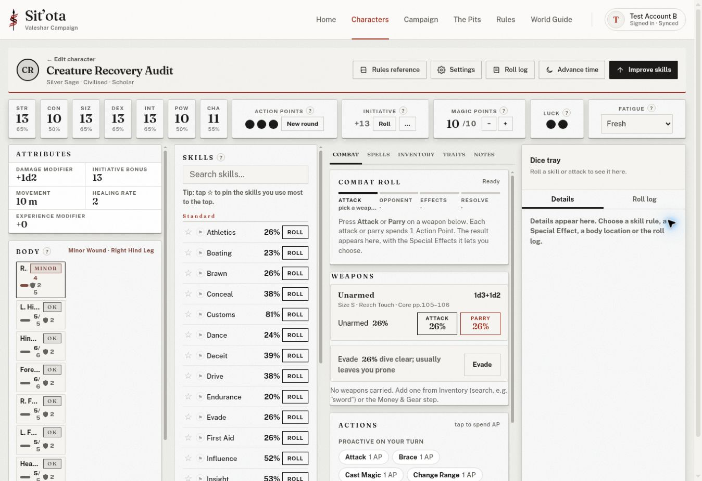
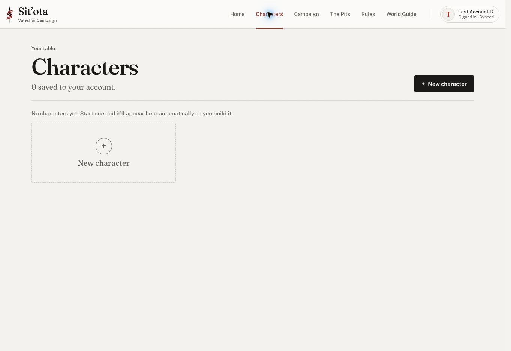

# Recovery remainder and creature tracker live checks — 2026-11-10

Progress **5/8**. Main Play Mode Combat stays CLOSED. Scope: live app acceptance, internal Chrome, sequential secure sign-ins; no direct database permission claims.

## Recovery remainder after #269

- Read AGENTS.md and HANDOFF.md from main at 1a63003 (#269), plus the prior recovery ledger and Claude review.
- Secure sign-in verified **Test Account C** before GM checks. Retained restored fixture: GM Tools opens and renders Anath, Brin and Bandit, with preserved Head 3/5 on Anath and session notes. Brin/Bandit have no location rows; no invented HP observed. The explicit missing-location 0/0 display case was not present in these retained cards, so that numerical display is not independently accepted.
- Rebuilt the disposable original source tracker through normal GM Tools: removed its three sparse synthetic cards, added Anath using the party picker, Recovery Guard using the NPC form, and Recovery Beast using the creature stat-block form. The beast is synthetic test data, not a quoted sourcebook entry. Source character sheets were not edited.
- App-created source tracker: Anath AP 1, human location maxima 1/3/2/1/1/1/1; Guard initiative 8, AP 2, seven locations 10/10; Beast AP 3, INS 13, seven creature locations (5/5 or 6/6), natural Bite, Formidable Natural Weapons. Round 2/cycle 1 and private notes retained.
- Downloaded populated campaign backup; restore preview showed three tracker entries, two B-owned characters, two custom entries, rules/home/briefing/private state. Restored both characters into another new campaign. The new app-created-tracker restore shares the older restored fixture’s name but has its own campaign identity and invite code.
- **PASS:** opened GM Tools on the new copy. All three cards render with the values above, creature stats/traits/skills and session notes. Anath is active; next is Recovery Beast. No crash.
- Secure switch verified **Test Account B** before player checks. **PASS:** original campaign still shows B’s Anath and Brin, both YOU, HP 10/10, AP 1, Luck 1/1; C remains GM; original briefing/rules persist.
- Downloaded both originals through B’s Account > Advanced / Backup. Compared the complete parsed character states with the corresponding pre-restore source-backup states by character name: **exact equality for both**, including stored library/owner metadata and campaignId. This complements the earlier original-archive equality evidence; it does not claim a fresh whole-archive comparison in this follow-up.
- **PASS:** B joined the new restored campaign with its new code. Player view shows C’s two copied characters, C as GM, and B with zero characters as PLAYER. The originals were not reassigned or claimed by joining.

## Limits and remaining work

- Second independent player owner, independent-account inventory races, profiles, phone/routes and full case reconciliation remain BLOCKED/OPEN as previously documented. D-S5 CI remains direct-access evidence. Subsystems 7 and 8 are not closed by these scoped results.
- Creation Audit and Magic Audit must be preserved; neither was present in B/C’s sampled character lists.

## Subsystem 7 live tracker pass

Synthetic fixture, using B’s own Disposable Live Acceptance campaign and the normal stat-block form. This checks application behavior against the handoff’s specified expectations; no new sourcebook ruling is made here.

| Check | Result and evidence |
| --- | --- |
| How many / Rabble | PASS: How many 3 produced three named cards. Set each to Rabble. Rolled d20 17, Left Foreleg, armour 2; input 3 gave 1 injury below HP 5. Injured card reports fled; all cards report 1 of 3 down and the rest flee. Other cards retain individual fighting status alongside the group instruction; no claim that their individual status changes automatically. |
| Underling | PASS: How many 4, all Underling. First 3-damage hit against armour 2 gives one injury, fights on. Second such hit makes that card withdrawing. A second creature’s first injury makes the group 2 of 4 down and the rest withdraw. |
| Vulnerable silver / worn armour | PASS: two Silver Sages, each location 2 natural + 3 worn. d20 1 selects Right Hind Leg, armour 5. Silver damage 6 gives 3 damage; UI explicitly says natural armour does not protect and worn armour 3 still counts. |
| Intimidate Critical / brethren | PASS: Audit Hero Critical on Sage 1 appears as ignores it on both Sage cards. Added Audit Other Failure (falls back); stopped threatening clears Other but keeps Hero on both. |
| Entry mechanics retained | PASS: Ability, Poison, Magic and Weapon effect synthetic lines all show as GM-resolved with their entered descriptions. |
| GM approval and copy | PASS: sapient INT 13 / CHA 11, all seven dice and Move; approval enables copied stat block. Points Build preview pool 83, ranges displayed. |
| Creature import rejection | PASS: Concept import refuses INT 7, and separately refuses INS (also reports missing INT). |
| Valid creature build / persistence | PASS at draft scope: imported GM-approved Silver Sage, allocated exactly 83/83 without override (STR13 CON10 SIZ13 DEX13 INT13 POW10 CHA11), Civilised culture with all 100 points and Scholar career with all 100 points. Saved draft appears in B’s Characters with species/culture/career; reloaded builder preserves species dice/ranges, pool and its own d20 anatomy. Remaining character creation steps were not completed; no end-to-end finished-sheet claim. B performed both GM approval and the character-builder path; a distinct player account consuming another GM’s block was not sampled. |
| Creature Play Mode | PASS: own seven creature location cards/ranges/natural armour, no human figure. Right Hind Leg 5/5, natural armour 2: damage 3 gives 1 HP taken, 4/5 Minor Wound. Reload retains 4/5 and other locations. |

### Presentation findings

- Concept import help still says Play Mode tracks human locations, although the observed Play Mode correctly uses the creature’s own anatomy. Claude should update that stale help text.
- Creature body cards are cramped at this desktop width: labels truncate and values wrap heavily. The full names and values remain accessible and open the proper location dialog. Screenshot records the presentation; no phone/layout acceptance claim.

## Cleanup complete

- Owner explicitly confirmed permanent cleanup and public docs publication in the follow-up conversation.
- Deleted all three C recovery campaigns (source, older sparse restored copy, new app-created restored copy), each through its named Delete forever confirmation. C's campaign list then showed no campaigns, and Characters showed **0 saved**.
- Secure sign-in positively verified **Test Account B**. Deleted Disposable Live Acceptance 20261109 through its named Delete forever confirmation. B's campaign list then showed no campaigns; Characters showed **0 saved**. This verifies removal of B's originals and the creature draft and C's restored/imported copies beyond optimistic delete toasts.
- Creation Audit and Magic Audit were absent from these B/C lists and were not touched. No other account's data was changed for cleanup.
- The delayed B authentication request expired; the owner requested another attempt. Fresh secure sign-in succeeded, and account identity was checked before cleanup. Signed out when finished.
- No credentials, emails, invite codes, account IDs or backup payloads included in these docs. No production changes.

Next: Chat reconciles these scoped results with Subsystems 7 and 8 closeout gates, preserving prior blockers and the unsampled limits above. Claude handles the stale Concept help and creature-card presentation findings. Progress remains **5/8**.

Validation: ran all 52 top-level tests/*.cjs scripts using the repository-required loop; command completed with exit 0. No failure was observed in returned output. `git diff --check` passed. Database permission tests were not rerun (no migration changes).
