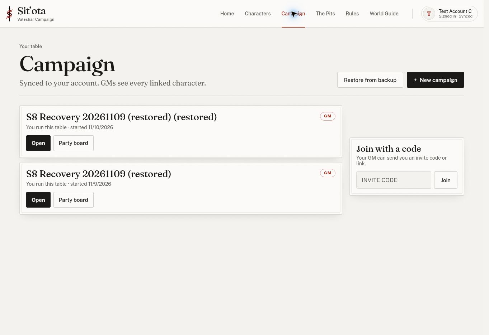

# Subsystem 8 recovery live checks — 2026-11-10

Progress **5/8**. Subsystem 8 remains OPEN; Main Play Mode Combat stays CLOSED. This is scoped evidence, not recovery closeout.

## Environment and fixture

- Read `AGENTS.md`, `HANDOFF.md` and `docs/subsystem8-recovery-contract.md` first. PR #267 is merged at `bc67116f936f34190e88a3fbfa2b89c60ba5c3e6`. Pages run [42774404053](https://github.com/colemak1/mythras-character-forge/actions/runs/42774404053) completed successfully for that commit; Tests run 42774405135 also succeeded.
- Internal Chrome, real signed-in test accounts B and C, switched sequentially through secure sign-in. No direct database-access acceptance tests were substituted for the app. Only app-downloaded JSON was compared locally.
- The available B campaign was empty. Prepared a disposable populated source through the app's restore control, using synthetic data derived from `tests/campaign-restore.cjs`: two characters (Anath, Brin), 1d6+1/Companion campaign settings, home quote/session, briefing, private notes, two PC tracker cards and one NPC, custom weapon Hook Blade and spell Ember.
- C joined; B used Make GM and its on-page confirmation to transfer GM to C. Before the actual round trip, B was a player owning both source characters; C was GM. **Both characters have one player owner, not two different player accounts.**
- Source: `S8 Recovery 20261109 (restored)`. Round-trip result: `S8 Recovery 20261109 (restored) (restored)`. The repeated suffix is expected because fixture setup itself used restore. No existing real campaign or player data was edited.

## Seven-step round trip

| Step | Result | Evidence and limits |
| --- | --- | --- |
| 1. Download populated source backup as GM | **PASS** | C downloaded through GM tools. File contained 2 members, 2 characters, 2 custom entries, campaign/rules/home/briefing and private state. |
| 2. Preview and untick a character, with no creation yet | **PASS, app scope** | Preview listed source name/date, rules, home, briefing, GM notes/tracker (3), 2 custom entries, both named B-owned characters and member-copy warning. Brin unticked. Campaign list still showed only the source before confirmation. |
| 3. Restore as new campaign | **PARTIAL PASS; tracker UI UNACCEPTED** | New campaign and new invite code; C sole member/GM, one C-owned Anath copy. Re-export confirmed equal rules/home, briefing, custom type/name/data and private notes. Anath's ID/owner/campaign link are new; its state differs only in campaignId. Tracker export links Anath to the new copy and clears Brin's link; NPC remains unlinked. See tracker fixture limit below. |
| 4. Original campaign, members and player characters unchanged | **PASS, exported data; player-after view BLOCKED** | Downloaded original again after restore: entire parsed archive equals the pre-restore archive after excluding only exportedAt. Includes campaign ID/name/GM/invite/rules/home/briefing, members, all original character rows/states/owners/links, private state and custom content. B's player view before restore showed both originals and C as GM. A final secure sign-in intended for B returned C, so no post-restore B view is claimed. |
| 5. Player joins restored campaign using new code | **BLOCKED** | Final account switch returned C (already the restored campaign's GM), not B. Joining the source during setup does not count as this step. No restored-campaign player join claimed. |
| 6. Pick one character from the same campaign file | **PASS** | Account > Advanced / Backup > Import character backup opened Characters with Brin/Anath pick list. Selected Brin; C's library increased from 1 to 2. Downloaded Brin through Account backups: concept name Brin, campaignId null, new library ID. Entry point is Account; selection appears on Characters. |
| 7. Unsupported version refused; nothing created | **PASS, app scope** | Changed only version to 2 in a temporary copy of the downloaded source file. Restore reported newer Forge version (version 2), nothing restored; both existing campaign cards remained, with no additional campaign or preview. |

## Tracker fixture limit / validation finding

The synthetic fixture copied the test's intentionally minimal combatants: Anath has only Head HP; Brin and Bandit omit full HP/card attributes. The restore accepted this structure. Opening GM Tools on the restored board raised `TypeError: Cannot read properties of undefined (reading 'max')` in `combatantCardHTML` (`js/cloud.js`, deployed line 1918), and the visible board remained on Live Status. No usable tracker UI or private-note UI pass is claimed. Saved/exported private state and relinking did pass.

This is **not evidence of a regression for a normally app-created tracker**: fixture construction was too sparse for the card renderer. Claude should decide whether accepted backup validation must reject/normalize such tracker shapes, and repeat the tracker portion with a source populated through normal GM Tools. Do not turn the export comparison into a full step-3 pass.

## Supabase automatic recovery — read only

- Connected Supabase `list_projects` identified Mythras Forge; `get_organization` for its owning organization returned **plan free / tier_free**, rechecked on 2026-11-10. No plan, backup setting, schema or data was changed through Supabase tools.
- Current official [Database Backups documentation](https://supabase.com/docs/guides/platform/backups), retrieved through Supabase documentation search, provides automatic daily backups/access for Pro (7 days), Team (14 days) and Enterprise (up to 30 days); it recommends manual off-site exports for Free projects. PITR is a paid-plan add-on.
- **This Free plan supplies no included user-accessible automatic daily-backup retention or PITR recovery entitlement.** No actual server restore points were inspected or restored. Do not promise server-side rollback or outage recovery beyond the app exports on this evidence. This is not a claim about Supabase's internal disaster-recovery infrastructure.
- Database backups exclude Storage API object contents. An app campaign JSON export is also not a complete database/Auth/Storage backup.

## Remainder and fixture disposition

- Recovery remains **UNACCEPTED as a complete seven-step live contract**: repeat the tracker UI with valid app-created combatants; finish B's post-restore original/copy checks and join the restored campaign. A second independent player owner was not sampled.
- Test fixtures are retained for those unfinished checks: source and restored campaigns, B's original Anath/Brin, C's restored Anath and imported unlinked Brin. They are disposable; clean them after the follow-up, leaving Creation Audit and Magic Audit intact. The unrelated empty Disposable Live Acceptance campaign was not changed.
- Independent simultaneous GM/player inventory races remain BLOCKED; global profiles, phone/routes/header/session checks, other races and full case reconciliation remain OPEN. D-S5 CI remains direct-access evidence; these UI checks make no RLS claim.
- Signed out after testing; no credentials, emails, invite codes, account IDs or backup payloads committed.
- Next: Claude reviews the tracker validation/fixture issue and this evidence; Work finishes only the listed live remainder when the correct player sign-in is available. Progress remains **5/8**.

Validation: all 52 `tests/*.cjs` scripts completed with no FAIL markers; `git diff --check` passed. Docs and one non-sensitive evidence image only; no production files changed.
